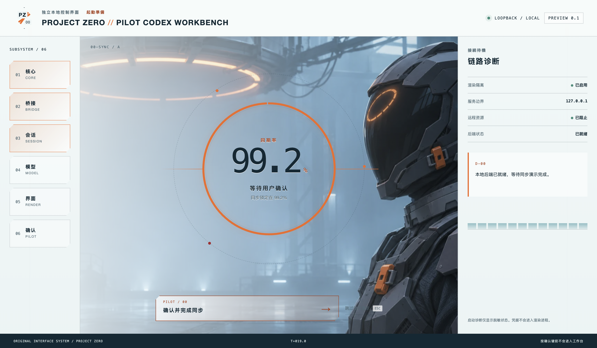

# PROJECT ZERO // PILOT CODEX WORKBENCH

这是一个面向 macOS 的**非官方**、本地优先 Codex 启动工作台预览。公开版本采用原创的
PILOT-00 / VOIDGLASS 视觉，不代表 OpenAI、EVA 或任何其他权利方，也不包含官方角色素材。



上图由当前仓库实际启动界面截取；公开构建会显示同步动画、Codex 本地就绪状态和确认门禁，
随后进入仍在开发中的工作台壳。

## 前置条件

- macOS（Apple Silicon 或 Intel）；构建命令只生成当前 Mac 架构的目录包。
- Node.js 24 或更高版本，以及随 Node.js 安装的 npm。
- 本机已安装可用的 Codex/ChatGPT 桌面运行时，并已登录 Codex 账号。

Codex 账号只提供账号与模型状态；应用文件、主题文件和本地构建产物不会因为另一台 Mac 登录
同一账号而自动同步。

## 本地运行与验证

```bash
npm ci
npm run verify
npm start
```

`npm run verify` 运行 ESLint 和不启动 Electron 的 Node 测试。完整源码与打包应用检查可运行：

```bash
npm run test:e2e
```

## 构建 macOS 目录包

```bash
npm run pack
```

Apple Silicon 输出在 `dist/mac-arm64/`，Intel 输出在 `dist/mac/`。当前预览包**未签名、未公证**，
首次打开可能被 macOS Gatekeeper 拦截。请在 Finder 中按住 Control 点击应用并选择“打开”，
或在“系统设置 → 隐私与安全性”中确认“仍要打开”。不要全局关闭 Gatekeeper。

如需只在本机制作不进入公开 Git 历史的私人主题，请阅读
[私人主题工作流](docs/private-themes.md)。

## 本地安全边界

- Electron 主进程只监听随机的 IPv4 loopback 地址 `127.0.0.1`，并校验精确 Host、Origin 和会话。
- 渲染器不启用 Node.js；界面仅加载打包 allowlist 中的本地文件，不加载远程素材。
- Codex 凭据不会进入渲染进程；诊断界面只显示稳定、脱敏的状态码。
- `npm run pack` 的公开路径不读取私人主题，测试 bridge 环境变量也会在生产打包时移除。

更完整的测试与产物边界见 [docs/testing-and-packaging.md](docs/testing-and-packaging.md)。

## 许可与素材说明

项目代码采用 [MIT License](LICENSE)。公开 VOIDGLASS 图像是独立授权的原创表达，具体按
[CC BY 4.0 与素材说明](assets/themes/project-zero/ASSET-LICENSE.md) 使用；该许可不替任何第三方
角色、商标或设计提供权利清理，也不是商业使用保证。

公开 GitHub 仓库不包含 Rei、EVA 或其他私人角色素材。私人素材必须由使用者自行合法取得、
保存在 ignored 本地目录，并自行承担分享或使用时的授权责任。

